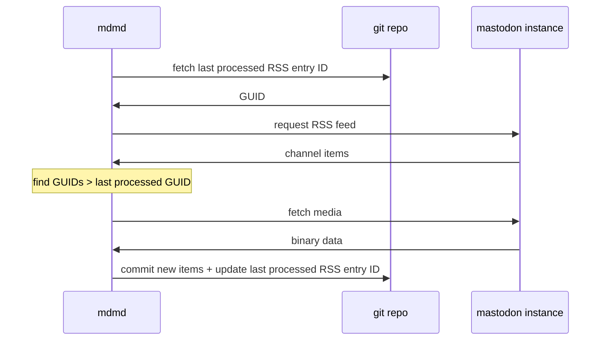

# mdmd - Mastodon RSS to Markdown files

This reads a Mastodon RSS feed, and for "new entries", writes markdown files to a Github repository.

- "New entries" are those lexically greater than a entry ID stored in Github (may be a dodgy assumption).

- The markdown format is probably specific to me, but suitable for use with [Hugo](https://gohugo.io/) and the like.

- Image and video files are also downloaded, referenced in the markdown, and added to Github.

`mdmd` produces markdown content of the form:

```
---
title: Tue 14 Mar 2023 08:23
instance: mastodon.green
toot_url: https://mastodon.green/@d6y/110020669786772308
date: 2023-03-14T08:23:12+00:00
---

<p>Things being repainted on <a href="https://mastodon.green/tags/brighton" class="mention hashtag" rel="tag">#<span>brighton</span></a> seafront this morning</p>


```

...which can render (in Hugo and similar) [like this](https://richard.dallaway.com/microposts/2023-03-14-toot-110020669786772308/).

# Development build

This is a Rust project.

You need a set of environment variables:

```
export GITHUB_TOKEN=???
export GITHUB_REPO=git_user/my_repo
export RUST_LOG=INFO,rustls=off
```

Then: `cargo run`

Or `cargo run -- -help` for more options.


# Docker build

```
docker build -t mdmd .
```

Example run:

```
docker run -it \
  -e GITHUB_TOKEN=$GITHUB_TOKEN \
  -e GITHUB_REPO=$GITHUB_REPO \
  -e RUST_LOG=$RUST_LOG \
  --rm --name running-mdmd mdmd
```


# Running as a Home Assistant app

The `homeassistant/` folder contains a local app for Home Assistant.

The app stays running and runs `mdmd` once each time an automation sends it a line of input.

Install steps from macOS:

## 1. Expose the Home Assistant `addons` folder to your Mac

If you have already done this for another app (e.g., dogpost), skip to step 2.

1. In Home Assistant go to _Settings > Apps_, and install **Samba share**.
2. On the app's _Configuration_ tab set a username and password, save, then **Start** it.
3. On the Mac, in Finder choose _Go > Connect to Server_ (⌘K) and enter `smb://homeassistant.local/addons` (or use IP address if that doesn't work).
   Log in with the Samba username and password. The share mounts at `/Volumes/addons`.
4. Check you can access the addons from your terminal: `ls /Volumes/addons`. If you can't check _System Settings > Privacy & Security > Files and Folders_ and for your terminal turn on "Network Volumes".

## 2. Copy the app across

From the root of this repository:

```
./homeassistant/install.sh
```

This copies the app files plus `Cargo.toml`, `Cargo.lock` and `src/` into `/Volumes/addons/mdmd`.
Pass a different folder as an argument if the share is mounted elsewhere.

## 3. Install the app

In Home Assistant go to _Settings > Apps_ and click **Install App**. Select `mdmd` and then press **Install**.

The Pi will now compile the code and this will take a while.

## 4. Configure

On the app's **Configuration** tab:

- `github_token` is the token used to read and write the repository.
- `github_repo` is the repository in the form `user/repo`, e.g., `d6y/richard.dallaway.com`.
- `github_branch` is the branch to commit to.
- `num_posts` is the maximum number of posts to copy per run.
- `log_level` is passed through as `RUST_LOG`.

Save, then **Start** the app. The **Log** tab should show `mdmd: waiting for triggers`.

The app only reads its options at startup, so **Restart** it after changing them.

## 5. Trigger it from an automation

Use the `hassio.addon_stdin` action (the app's id is `local_mdmd`).
This time follows Home Assistant's timezone:

```yaml
alias: mdmd daily
triggers:
  - trigger: time
    at: "13:00:00"
actions:
  - action: hassio.addon_stdin
    data:
      addon: local_mdmd
      input: run
mode: single
```

To test by hand, go to _Developer tools > Actions_, run `hassio.addon_stdin` with the data above, and watch the app's **Log** tab.

**Warning:** there is no dry run. If there's a new post, a run commits it to the repository for real.

## 6. Cutover from the old job

1. Install and configure the app, and leave the automation disabled.
2. Pause the old `mdmd-job`.
3. Trigger a run by hand and check the log. A failed run shows `mdmd: failed`.
   If there was a new post, check the commit in the repository, including any media.
   If there was nothing new, the first real commit will come from a later run, so check that one instead.
4. Enable the automation.

The old job can be removed once the new one has run reliably.

## Updating

After changing the code, run `./homeassistant/install.sh` again, press the "refresh" icon on the Apps page in HA, then select **Update** on the app's page.

After changing `homeassistant/mdmd/config.yaml` (e.g., the settings), Rebuild is not enough:

1. Increase `version` in `config.yaml`.
2. Run `./homeassistant/install.sh`.
3. In the Home Assistant _Terminal_:

   ```
   ha store reload
   ha apps update local_mdmd
   ```

# Network back and forth


